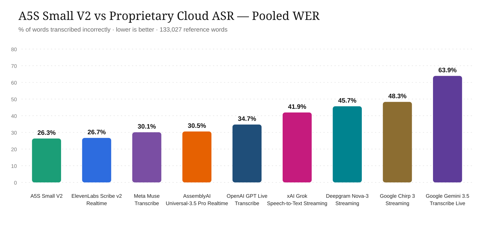
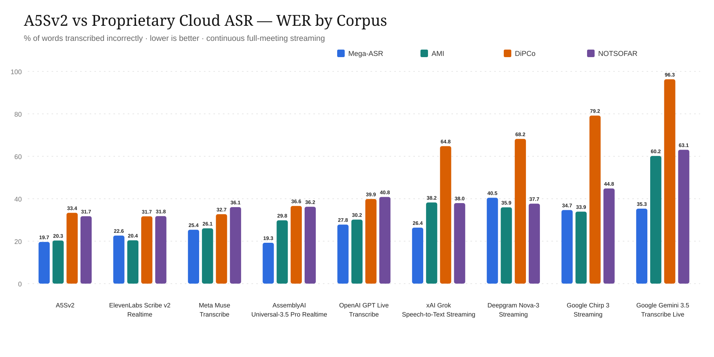
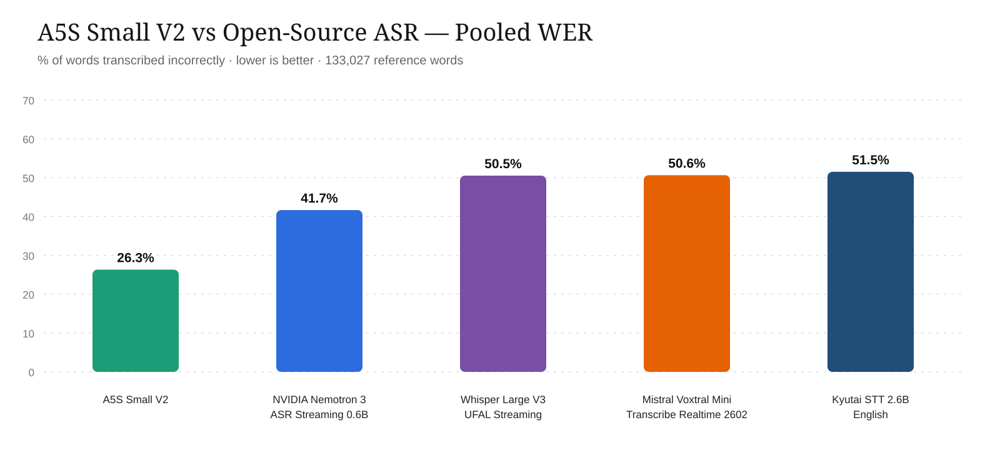
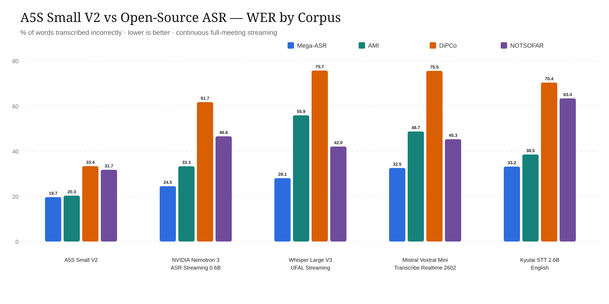

# A5S Small V2 ASR benchmark

Reproducible streaming ASR evaluation on four public English corpora. Each corpus contributes
about 33k normalized reference words. The primary aggregate is the unweighted mean of the four
corpus WERs; pooled WER is also reported. All values use one saved transcript run per system and
corpus; no multi-run averaging is used. A5S Small V2 uses the 18,000-step checkpoint; all results use
the frozen word-onset v2 references.

**Dataset:** [`AirCaps/a5s-small-v2-asr-benchmark-dataset`](https://huggingface.co/datasets/AirCaps/a5s-small-v2-asr-benchmark-dataset)

| Corpus | Fixed selection | Audio | Reference words |
|---|---|---|---:|
| [Mega-ASR / Voices-in-the-Wild-2M](https://huggingface.co/datasets/zhifeixie/Voices-in-the-Wild-2M) | 1,250 utterances; 250 per condition | stored mono utterances | 32,928 |
| [AMI](https://groups.inf.ed.ac.uk/ami/corpus/) | 7 scenario-only unseen-evaluation meetings | `Array1-01`, 0 dB | 32,928 |
| [DiPCo](https://zenodo.org/records/8122551) | 5 eval meetings + 1 dev meeting | `U01.CH1`, +5.1 dB | 33,679 |
| [NOTSOFAR](https://huggingface.co/datasets/microsoft/NOTSOFAR) | 22 eval-small meetings | `sc_meetup_0/ch0.wav`, 0 dB | 33,492 |

Exact IDs, revisions, reference parsing, audio handling, and requests are frozen in
[`PROTOCOL.md`](PROTOCOL.md).

## Proprietary cloud results

WER (%), lower is better. Every system completed all 1,250 utterances and 35 full meetings.
Meeting recordings are streamed continuously, without segmentation.

| System | Mega-ASR | AMI | DiPCo | NOTSOFAR | Macro | Pooled |
|---|---:|---:|---:|---:|---:|---:|
| A5S Small V2 | 19.651968 | **20.314018** | 33.365005 | **31.747880** | **26.269718** | **26.333000** |
| ElevenLabs Scribe v2 Realtime | 22.643343 | 20.411200 | **31.705217** | 31.807596 | 26.641839 | 26.692326 |
| Meta Muse Transcribe | 25.376579 | 26.059888 | 32.711779 | 36.053386 | 30.050408 | 30.090884 |
| AssemblyAI Universal-3.5 Pro Realtime | **19.254130** | 29.831754 | 36.607381 | 36.229547 | 30.480703 | 30.539665 |
| OpenAI GPT Live Transcribe | 27.812196 | 30.159742 | 39.861635 | 40.845575 | 34.669787 | 34.725281 |
| xAI Grok Speech-to-Text Streaming | 26.369655 | 38.244048 | 64.779239 | 37.952347 | 41.836322 | 41.949379 |
| Deepgram Nova-3 Streaming | 40.457969 | 35.945092 | 68.187892 | 37.683626 | 45.568645 | 45.662911 |
| Google Chirp 3 Streaming | 34.675656 | 33.928571 | 79.185843 | 44.849516 | 48.159897 | 48.321018 |
| Google Gemini 3.5 Transcribe Live | 35.319485 | 60.161565 | 96.279581 | 63.065807 | 63.706609 | 63.887782 |





Machine-readable scores are in [`results/`](results). The companion dataset publishes the exact
references, saved predictions, run metadata, and SHA-256 checksums. A5S Small V2 inference code is not
published; its predictions are included so every score can be reproduced independently. This
release reports point estimates only.

## Open-source comparison

| System | Mega-ASR | AMI | DiPCo | NOTSOFAR | Macro | Pooled |
|---|---:|---:|---:|---:|---:|---:|
| A5S Small V2 | **19.651968** | **20.314018** | **33.365005** | **31.747880** | **26.269718** | **26.333000** |
| NVIDIA Nemotron 3 ASR Streaming 0.6B | 24.489796 | 33.318149 | 61.715015 | 46.575302 | 41.524565 | 41.659964 |
| Whisper Large V3 (UFAL Whisper-Streaming) | 28.058188 | 55.864310 | 75.691083 | 42.048847 | 50.415607 | 50.522826 |
| Mistral Voxtral Mini Transcribe Realtime 2602 | 32.546769 | 48.712342 | 75.521839 | 45.300370 | 50.520330 | 50.639344 |
| Kyutai STT 2.6B English | 33.175413 | 38.535593 | 70.358384 | 63.355428 | 51.356204 | 51.514354 |





Pinned public models and inference methods are documented in
[`docs/OPEN_SOURCE_MODELS.md`](docs/OPEN_SOURCE_MODELS.md).

## Quickstart

```bash
python -m venv .venv
source .venv/bin/activate
python -m pip install -e ".[api]"
python -m a5sv2_eval.prepare mega meetings
cp .env.example .env
```

Add credentials to `.env`, then run and score the saved manifests:

```bash
set -a; source .env; set +a
python -m a5sv2_eval.run_all deepgram assemblyai google openai elevenlabs meta grok gemini \
  --manifest benchmark_data/mega/manifest.jsonl --output-dir benchmark_data/results --trials 1
python -m a5sv2_eval.run_all deepgram assemblyai google openai elevenlabs meta grok gemini \
  --manifest benchmark_data/meetings/manifest.jsonl --output-dir benchmark_data/meetings/results \
  --trials 1 --concurrency 8
python -m a5sv2_eval.score benchmark_data/results/*.jsonl benchmark_data/meetings/results/*.jsonl
```

Audio is paced in real time; concurrency changes wall time only. Provider-specific session rules
are documented in [`PROTOCOL.md`](PROTOCOL.md). Use `--limit 2 --trials 1` on one provider module
for a paid smoke test.

## License

Apache-2.0. Provider APIs and source corpora remain subject to their own terms and licenses.

## Mega-ASR disclosure

We sampled from **Mega-ASR-Train**, rather than the standard Mega-ASR test set, because in our
experiments the standard test set was not acoustically challenging enough to clearly discriminate
among robust ASR systems. This derived evaluation set must not be mixed into training when
reporting results on it.

A5S Small V2 was not trained, fine-tuned, checkpoint-selected, hyperparameter-tuned, prompt-tuned, or
otherwise optimized using these exact 1,250 recordings or transcripts. We cannot determine
whether third-party systems used these items or overlapping upstream data. This exact-item
statement is not a claim of distribution-level independence; Mega-ASR should be interpreted as a
developer-created robustness diagnostic alongside the three meeting corpora.
